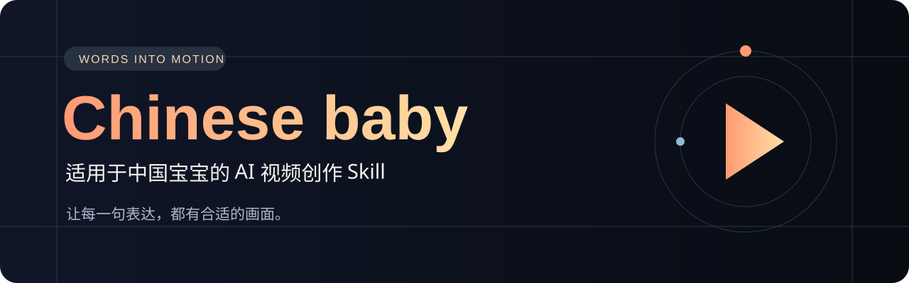

<div align="center">



**故事叙事 · 动态影像 · 视觉设计 · 视频创作**

一套面向中文创作者、可随作品持续进化的 AI 视频创作 Skill。

[快速开始](#使用方式) · [能力概览](#能帮助你完成什么) · [工作流](#工作流与目录) · [意图合同](references/intent-contract.md) · [风格合同](references/style-contract.md)

</div>

---

## 关于 Chinese baby

Chinese baby 面向中文故事叙事、知识科普、动态视觉、产品动画、自媒体视频与口播剪辑，将内容理解、导演设计、分镜、素材编排、动画合成和验收组织成可执行、可修改、可追溯的工作流。把一个想法、故事、稿件、主题或现成素材交给 AI，让它设计角色、场景、镜头、情绪与节奏，再根据可用工具完成制作。

它可以从一段口播出发，也可以从一个故事开始：用像素角色推进冒险，用水墨山河表达情绪，用暗金图形展开推理，或用连续形变呈现产品与关系。具体风格按作品选择，口播剪辑只是其中一种任务。

## 为什么要做 Chinese baby

这个项目来自一次具体的创作经历：看到同行用 AI 做出有表现力的视频，也想把自己的口播剪得更好。尝试教程、开源项目和不同工具后，账号能否使用、项目能否运行、效果能否适配中文内容，逐渐成为现实门槛。

即使成功运行，画面也可能仍然单调：人物一直在主屏幕，字幕跟着口播走，图片偶尔出现，动画和内容之间缺少联系。创作者知道工具可以做更多，却缺少一种方法，把内容、镜头和实现能力连接起来。

Chinese baby 从这类实际问题出发，把中文创作中的有效经验整理为 AI 能理解和执行的工作流。“Chinese baby”取自“适用于中国宝宝”，希望更贴近中文表达、中文排版和中文口播习惯，也给首次尝试 AI 视频制作的人一个清楚的入口。

## 每句话，都值得有合适的画面

“我真的受不了了”可以用动态字、镜头推进与短暂停顿传递情绪；“被拦在门外”可以用路径与阻挡表达关系；“剪出来很僵硬”可以用有意停顿的阶梯动作帮助观众理解；讲到解决方案时，让画面从问题的收紧状态展开成清楚的流程。

每幕都先回答：观众听到这句话时，看到什么会更容易理解、更愿意继续看？

## 能帮助你完成什么

| 能力 | 具体工作 |
| --- | --- |
| 理解内容 | 从故事、主题、稿件或口播中梳理角色、对象、冲突、转折、情绪与结论 |
| 编排素材 | 将图片、人物、录屏和片段对应到原句，区分证据、例子、解释与情境 |
| 导演设计 | 安排人物、素材、动态字、图形之间的焦点交接，以及进入、强调、停留、退出 |
| 中文排版 | 字幕专名校正、字号层级、换行、安全区、强调色与文字动画 |
| 剪辑合成 | 压缩拖沓空白，保留叙事停顿，处理多片拼接、字幕时间映射与录音响度差异 |
| 交付与复核 | 根据任务交付MP4或交互动画，保留时间轴、分镜、素材登记与验证记录 |

这里的“理解”不是把用户的话换一种说法。工作流先锁定主任务、观众目标、必须证明的内容、案例与整体的范围以及用户最新纠正；再比较三种叙事结构，建立风格、摄影机、转场和声音合同。这样效果服务内容，案例不会被误当成产品全部能力，模型被纠正后也会回到最早发生误解的阶段重做。

## 从第一秒开始，作品就已经在展示能力

创作者还在叙述背景时，观众已经开始判断视频是否值得继续看。开场、铺垫、解释和总结都应有意识地组织画面与节奏。一个准确出现的素材、一段醒目的文字动作、一次有意义的停顿，都可以承担表达。

人物窗、画幅、配色和动效强度服从当前作品。圆形人物窗可成为某个系列的视觉身份；其他内容也可以使用全屏人物、白板、录屏或故事混剪，不将单次项目偏好固化成通用模板。

## 使用方式

克隆本仓库，将整个目录放在你的项目中，让支持读取本地文件的 AI 编码助手先阅读 `AGENTS.md` 和 `SKILL.md`。这是项目级工作流，不需要自动安装为全局Skill。

```bash
git clone https://github.com/Lappercn/ChineseBaby.git
```

可以直接这样提出任务：

> 请先阅读 ChineseBaby/AGENTS.md 和 ChineseBaby/SKILL.md，使用 Chinese baby 工作流剪辑我的口播。先理解上下文，再按段编排素材。从第一秒起设计视觉节奏，保留有意义的停顿，交付实际MP4和可编辑字幕。请把这条视频复制到独立工程中制作，不覆盖通用母版。

也可以提供主题或稿件：

> 用 Chinese baby 将这份中文稿件做成动态讲解视频。请说明导演思路、逐句分镜、素材用途和实现选择；缺少非关键素材时继续推进，涉及关键事实时向我确认。

支持Skill目录的宿主也可将本目录按其规则加载；具体安装和调用方式以宿主为准。仓库本身不附模型、FFmpeg或渲染环境，制作时检查当前机器真正可用的工具。没有统一“一键生成”命令。

## 工作流与目录


| 阶段 | 目录 | 产物 |
| --- | --- | --- |
| 需求 | `00-brief/` | 原稿、目标、约束、待确认项 |
| 导演 | `01-direction/` | 基调、情绪、视觉规格 |
| 分镜 | `02-storyboard/` | 逐句镜头、动作与时间轴 |
| 素材 | `03-assets/` | 来源、用途、焦点与替换槽位 |
| 制作 | `04-production/` | 实现、合成配置与依赖记录 |
| 验收 | `05-review/` | 内容、画面、音轨与技术证据 |
| 交付 | `06-delivery/` | 视频或交互成品与修改说明 |

- `SKILL.md`：原则、适用任务及参考路由。
- `AGENTS.md`、`WORKFLOW.md`：项目入口和阶段交接。
- `references/`：上下文、风格、剪辑、动效、工具及内容验收方法。
- `references/intent-contract.md`：持续锁定主任务、范围、案例角色和用户纠正。
- `references/style-contract.md`：把审美转成材质、运动、摄影机、转场、声音和失败检查。
- `components/`：能力复用契约与登记，不代表已内置所有效果。
- `scripts/inspect_video.py`：本地抽帧与联系表工具，需要Python、Pillow和FFmpeg。

建议一条作品使用一个独立工程。母版保留通用方法，单片保存自己的素材、文案、配置和验证证据。

## 能力与边界

工作流不绑定某一个模型或单一动画引擎。先看内容需要什么，再检查环境能够做什么，选择适合的实现。结果受到模型理解能力、素材质量、运行环境和工具支持的影响；这不是对任意模型或任意电脑效果一致的保证。

已在本地项目实践过：带时间码的转写、精简字幕、圆形人物合成、语义图形动画、多段视频拼接、分别校准录音响度、H.264/AAC导出与完整解码检查。相关工具需要在新环境重新核验。

三维、物理流体、真实折射、生成视频及各种框架插件属于按需选用的路线，只有实际接入并验证后才能声称实现。技术解码通过也不等于逐字听辨和连续主观观看通过。

## 让每次制作成为下一次的积累

首秒编排、焦点交接、语义动作、中文动态字、圆窗避让、不同录音响度匹配和成片核验等经验，沉淀在[剪辑与动效经验](references/editing-motion-playbook.md)。它们记录适用条件与常见失败方式，帮助下一条作品从已解决的问题继续向前。

原始口播、第三方参考帧、模型权重、本机依赖与机器私有路径不作为本仓库发布内容。创作时使用的素材应另行登记来源和使用范围。

**Chinese baby——让你的每一句表达，都有合适的画面。**


## 参与改进

欢迎提交 Issue 讨论中文口播、叙事节奏、素材组织、工具适配和真实制作中遇到的问题。反馈时提供复现步骤、期望效果、运行环境和必要的脱敏片段；请勿提交账号凭据、模型权重或未经授权的视频素材。

提交改进时，说明它适用于什么任务、解决什么问题，以及如何验证。将通用方法写入Skill或参考，将具体作品保留在独立工程中。

---

<div align="center">

**你负责表达，我们一起把表达变成画面。**

Chinese baby · Words into motion

</div>
